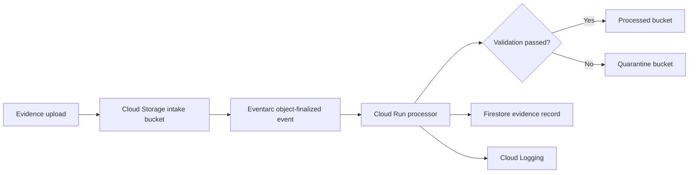

# EvidenceFlow

A secure, event-driven evidence-processing pipeline built on Google Cloud.

EvidenceFlow receives uploaded files, validates their type and size, calculates a SHA-256 checksum, routes them to a trusted or quarantine location, and records an auditable result in Firestore.

## Project status

Application logic and local validation are complete. Cloud Run deployment and Eventarc integration are the next infrastructure milestone.

## The problem

Evidence files should not enter a trusted archive without validation and traceability. Manual processing can lead to misplaced files, misleading file types, duplicate processing, missing integrity information, and incomplete audit records.

EvidenceFlow automates that workflow with managed, serverless Google Cloud services.

## Architecture



## Processing workflow

1. A file is uploaded to the private intake bucket.
2. Cloud Storage emits an object-finalized event.
3. Eventarc sends the event to the Cloud Run service.
4. The processor validates the file's size, extension, declared content type, and signature.
5. It calculates a SHA-256 checksum for files within the configured size limit.
6. Valid files are copied to the processed bucket.
7. Invalid files are copied to the quarantine bucket.
8. Firestore receives a searchable processing record.
9. Structured results and errors are written to Cloud Logging.

## Supported evidence types

- PDF
- PNG
- JPEG
- Plain text

The default maximum file size is 10 MB and can be changed through configuration.

## Security controls

- Private buckets with Public Access Prevention enabled
- Uniform bucket-level access
- Dedicated runtime service account
- Read-only access to the intake bucket
- Create-only access to the processed and quarantine buckets
- Firestore data access without database-administrator privileges
- Cloud Storage generation preconditions to prevent overwrites
- Deterministic evidence IDs for idempotent event retries
- Rejection of unsupported event types
- No service-account keys stored in the repository

## Google Cloud services

- Cloud Run
- Eventarc
- Cloud Storage
- Firestore
- Cloud Logging and Monitoring
- Cloud Build and Artifact Registry
- Identity and Access Management

## Firestore evidence record

Each file produces a record containing fields such as:

- Evidence and event IDs
- Source bucket, object name, and generation
- Destination bucket and object name
- Processing status
- File size and content type
- SHA-256 checksum
- Validation messages
- Received and processed timestamps

## Configuration

| Variable | Purpose |
| --- | --- |
| `INTAKE_BUCKET` | Bucket containing new uploads |
| `PROCESSED_BUCKET` | Destination for files that pass validation |
| `QUARANTINE_BUCKET` | Destination for files that fail validation |
| `MAX_FILE_BYTES` | Maximum allowed file size in bytes |

See `.env.example` for example values. These values are deployment configuration, not credentials.

## Local development

### Requirements

- Node.js 24
- npm

### Install and run

```bash
nvm use
npm install
npm start
```

The service listens on port `8080` by default.

### Health check

```bash
curl http://localhost:8080/health
```

Expected response:

```json
{"status":"ok","service":"evidenceflow"}
```

### Run tests

```bash
npm test
```

## Cost controls

- Event-driven processing instead of an always-running server
- Cloud Run configured to scale to zero when idle
- A restricted maximum instance count for deployment
- A 10 MB default file limit
- Google Cloud budget alerts at 50%, 90%, and 100% of a USD 5 budget

## Current limitations

- File-signature validation is not a replacement for antivirus or malware scanning.
- The first version supports four file formats.
- Oversized files are quarantined without being downloaded into application memory.
- Intake objects are retained after processing.
- This is a portfolio and learning project, not a production forensic evidence system.

## Roadmap

- Deploy the processor to Cloud Run
- Configure a Cloud Storage Eventarc trigger
- Add integration tests against a dedicated test project
- Add Cloud Monitoring alerts and a dashboard
- Add malware-scanning integration
- Add retention policies and lifecycle rules
- Add architecture and threat-model documentation

## Author

Built by Ayomide Olojo as a practical Google Cloud engineering portfolio project.
